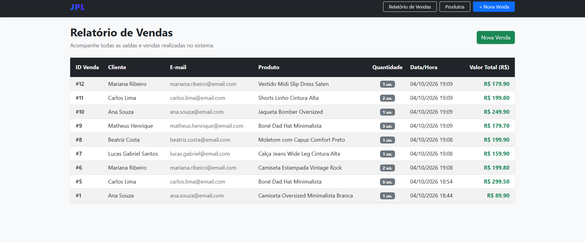
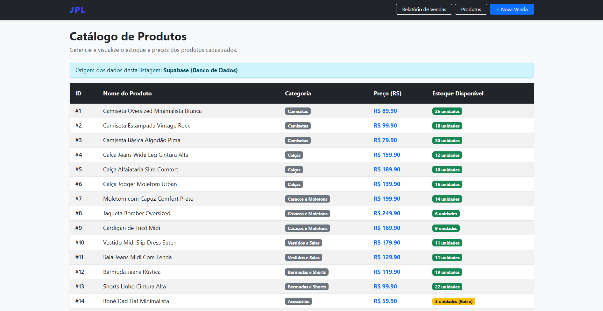
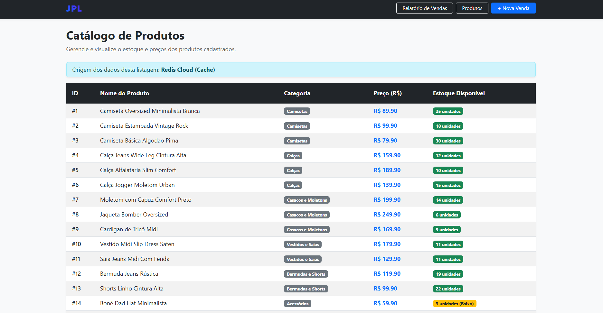
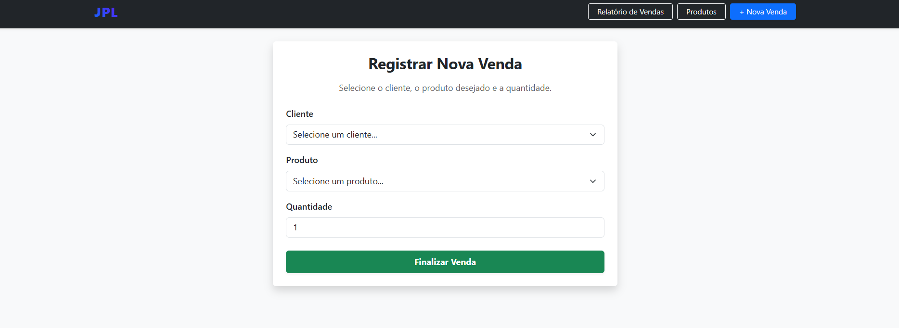

# Sistema de Gerenciamento de Loja (JPL)

## 🔄 Histórico e Evolução do Projeto
Este projeto consiste em uma evolução de um sistema de gerenciamento de loja que já havia sido desenvolvido anteriormente. A principal mudança arquitetural realizada nesta versão foi a migração e desacoplamento do backend para a nuvem: o banco de dados local foi substituído pelo **Supabase (PostgreSQL)** para garantir segurança e escalabilidade nas transações, e foi implementada uma camada de cache de alta performance utilizando o **Redis Cloud** para otimizar as consultas de produtos.

## 🎯 Objetivo e Principais Funcionalidades
- **Objetivo:** Desenvolver uma aplicação web full-stack integrada a um banco de dados relacional na nuvem e a uma camada de cache em memória.
- **Funcionalidades:**
  - Listagem de produtos com controle dinâmico de origem (Banco de Dados vs. Cache).
  - Cadastro e realização de vendas com consistência de estoque garantida por procedimentos armazenados (Stored Procedures).
  - Atualização automática de relatórios e invalidação de cache.

## 🛠️ Tecnologias Utilizadas
- **Backend:** Python, Flask
- **Banco de Dados:** PostgreSQL (hospedado no Supabase)
- **Cache:** Redis Cloud
- **Frontend:** HTML, CSS, Bootstrap 5, Jinja2
- **Controle de Versão:** Git e GitHub

## 🗄️ Integração com o Supabase
O Supabase (PostgreSQL) foi utilizado como o banco de dados oficial da aplicação. Toda a estrutura relacional (tabelas de produtos, categorias e vendas) reside nele. A regra de negócio principal de fechamento de venda (pr_realizar_venda) é executada diretamente no banco devedor por meio de procedimentos armazenados, garantindo a integridade e a baixa acoplagem do estoque.

## ⚡ Utilização e Escolha do Redis
- **Onde foi utilizado:** Na rota de listagem de produtos (/produtos), atuando como uma camada de cache intermediária.

- **Como funciona:** Quando o usuário acessa os produtos pela primeira vez, os dados são buscados no Supabase e salvos no Redis com um tempo de expiração (TTL) de 60 segundos. Nas requisições seguintes dentro desse período, a aplicação lê diretamente do Redis Cloud.

- **Por que foi escolhido:** O Redis foi escolhido por sua arquitetura baseada em memória RAM, o que proporciona tempos de resposta na ordem de microssegundos, reduzindo drasticamente a carga sobre o banco de dados relacional e acelerando a experiência do usuário.

## 📸 Capturas de Tela

* **Tela Inicial / Relatório de Vendas:**  
<div align="center">
  
</div>

* **Catálogo de Produtos:**  
<div align="center">
  
</div>

<div align="center">
  
</div>

* **Cadastro de Nova Venda:**  
<div align="center">
  
</div>

## 📹 Vídeo de Apresentação
* **Link da Apresentação:** https://canva.link/g59a15nqakfnd0v
  
## 🚀 Instruções para Instalação, Configuração e Execução

1. Clone o repositório ou baixe os arquivos do projeto.
2. No terminal, navegue até a pasta `src`:
   ```bash
   cd src
3. Instale as dependências necessárias:
   ```Bash
   pip install Flask psycopg2-binary redis
4. Configure as variáveis de ambiente com suas credenciais do Supabase e do Redis Cloud.
5. Execute a aplicação:
   ```Bash
   python app.py
6. Acesse no navegador: http://127.0.0.1:5000/
